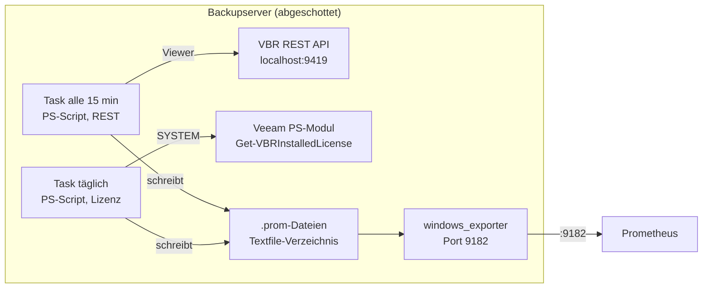

# Veeam Exporter – Metrik-Schema (Entwurf)

Stand: 2026-11-06 · Quelle: [Claude Doc](https://claude.ai/artifact/EpxXTfynm6cMZTUmebELNa)

## Ziel & Scope

Der Exporter liefert pro VBR-Server fünf Mindest-Signale als Prometheus-Metriken. Gesammelt wird lokal, ausgeliefert über den bestehenden windows_exporter.

| Anforderung | Frage, die beantwortet wird |
| --- | --- |
| Jobs | Welche Jobs gibt es, sind sie aktiv, wann liefen sie zuletzt? |
| Resultat | Success, Warning oder Failed beim letzten Lauf? |
| Nicht gesicherte VMs | Welche Objekte eines Jobs sind im letzten Lauf fehlgeschlagen? |
| Repository-Speicher | Wie viel ist frei und belegt, pro Repository und SOBR-Extent? |
| Lizenzablauf | Wann läuft die Lizenz ab, wie viele Instanzen sind belegt? |

## Architektur & Datenquelle

Ein PowerShell-Script läuft als geplanter Task lokal auf dem VBR-Server, fragt die REST API auf localhost:9419 ab und schreibt eine .prom-Datei ins Textfile-Verzeichnis des windows_exporter. Prometheus scrapt wie heute Port 9182; es entsteht kein neuer Port und kein Netzwerkpfad zum Backupserver.



Beide Tasks laufen lokal auf dem Backupserver. Nach aussen geht nur der bestehende Scrape auf Port 9182.

- **Intervall:** alle 15 Minuten (Vorschlag), Daten also höchstens 15 Minuten alt.
- **Runtime:** Windows PowerShell 5.1 und PowerShell 7, ohne Veeam-Console und ohne Veeam-PS-Modul.
- **Auth:** OAuth2 Password-Grant auf `/api/oauth2/token`; Access-Token 15 Minuten, Refresh-Token 24 Stunden gültig. Pro Lauf anmelden, am Ende `/api/oauth2/logout` ([Veeam REST Overview](https://helpcenter.veeam.com/references/vbr/13/rest/1.3-rev0/tag/SectionOverview)).
- **API-Version:** `x-api-version` in jedem Request. Das Script nimmt die höchste Revision, die der Server anbietet: 1.3-rev2 (13.1), 1.3-rev1 (13.0.1), 1.3-rev0 (13.0), 1.2-rev1 (12.3.1).
- **Credential:** lokaler Veeam-User, Passwort per DPAPI (`Export-Clixml`) für das Task-Konto verschlüsselt; liegt nur auf dem Server selbst.
- **Rolle:** Veeam Backup Viewer reicht für Jobs, Sessions und Repositories. Die Lizenz liefert REST nur an Veeam Backup Administrator, siehe Abschnitt Lizenz.
- **Datei schreiben:** erst `<name>.prom.tmp`, dann umbenennen (atomar). UTF-8 ohne BOM, LF-Zeilenenden, Zeilenumbruch am Dateiende. Nicht `Out-File` unter 5.1 verwenden, das schreibt UTF-16.

## Jobs & Resultate

Ein Call auf `GET /api/v1/jobs/states` liefert alle Werte. Die Rolle Veeam Backup Viewer reicht, pro Seite kommen standardmässig 200 Jobs ([Jobs-Referenz](https://helpcenter.veeam.com/references/vbr/13/rest/1.3-rev0/tag/Jobs#operation/GetAllJobsStates)). Ausgabe in `veeam_jobs.prom`.

| Metrik | Labels | Wert | API-Feld |
| --- | --- | --- | --- |
| `veeam_job_info` | job_name, job_id, job_type, workload, repository | 1 | id, type, workload, repositoryName |
| `veeam_job_last_result` | job_name, job_type | 0 Success, 1 Warning, 2 Failed, -1 None | lastResult |
| `veeam_job_enabled` | job_name | 1 aktiv, 0 deaktiviert | status ≠ disabled |
| `veeam_job_running` | job_name | 1 läuft gerade | status = running, starting, stopping |
| `veeam_job_last_run_timestamp_seconds` | job_name | Unix-Zeit | lastRun |
| `veeam_job_next_run_timestamp_seconds` | job_name | Unix-Zeit, fehlt bei verketteten Jobs | nextRun |
| `veeam_job_objects` | job_name | Anzahl Objekte im Job | objectsCount |

Alle Metriken sind Gauges.

- **Label `job_name` statt `job`:** `job` setzt Prometheus selbst beim Scrape; ein gleichnamiges Label würde zu `exported_job` umbenannt.
- **Retries:** REST zeigt nicht an, ob nach einem Fehler noch ein Retry kommt ([Veeam Forum](https://forums.veeam.com/viewtopic.php?p=453319)). Ein Failed im Retry-Fenster ist also normal. Alerts brauchen ein `for` über das Fenster (Veeam-Default 3 Retries à 10 Minuten).
- **Abgedeckte Job-Typen** laut API-Enum: vSphere- und Hyper-V-Backup, vSphere-Replica, Backup Copy, Agent (Windows, Linux), Cloud Director, Entra ID. Tape, File Share und SureBackup stehen nicht im Enum, siehe offene Punkte.

## Nicht gesicherte VMs (pro Objekt)

Pro Job und Objekt zählt der jüngste Task-Lauf. Ein erfolgreicher Retry überschreibt so den vorherigen Fehler automatisch. Ausgabe in `veeam_objects.prom`.

1. `GET /api/v1/sessions` mit `typeFilter=BackupJob,ReplicaJob` und `createdAfterFilter=<jetzt − Lookback>`: Zuordnung sessionId → Job.
2. `GET /api/v1/taskSessions` mit `createdAfterFilter=<jetzt − Lookback>`, gepaged über `skip`/`limit`: ein Eintrag pro Objekt und Lauf mit name, result, sessionId, endTime.
3. Pro Job und Objekt den Eintrag mit der neuesten creationTime behalten.

Beide Endpoints sind für Veeam Backup Viewer freigegeben und ab 1.2-rev1 (12.3.1) in der Referenz vorhanden ([Sessions-Referenz](https://helpcenter.veeam.com/references/vbr/13/rest/1.3-rev0/tag/Sessions#operation/GetAllTaskSessions)). Lookback-Vorschlag: 8 Tage, damit Wochen-Jobs nicht herausfallen. Aus einem Job entfernte Objekte verschwinden nach Ablauf des Lookbacks.

| Metrik | Labels | Wert | API-Feld |
| --- | --- | --- | --- |
| `veeam_object_last_result` | job_name, object | 0 Success, 1 Warning, 2 Failed, -1 None | result.result |
| `veeam_object_last_run_timestamp_seconds` | job_name, object | Unix-Zeit | endTime, solange laufend creationTime |
| `veeam_object_last_processed_bytes` | job_name, object | Bytes | progress.processedSize |
| `veeam_object_last_failure_info` | job_name, object, message | 1, nur bei Warning oder Failed | result.message |

- **Label `object` statt `vm`:** Task-Sessions enthalten auch Agents und File Shares, z. B. `winsrv88:/C:\shares\nfs_share` im Veeam-Beispiel.
- **`message` ist Freitext:** auf 200 Zeichen kürzen, Zeilenumbrüche entfernen, `\` und `"` escapen. Nur für Warning und Failed, damit die Zahl der Serien klein bleibt.
- **Kardinalität:** eine Serie pro Job und Objekt und Metrik.

```text
# HELP veeam_object_last_result Letzter Task-Lauf: 0 Success, 1 Warning, 2 Failed, -1 None
# TYPE veeam_object_last_result gauge
veeam_object_last_result{job_name="Backup Job 1",object="linbase01"} 0
veeam_object_last_result{job_name="Backup Job 1",object="winsrv88"} 2
veeam_object_last_failure_info{job_name="Backup Job 1",object="winsrv88",message="<result.message, gekürzt>"} 1
```

## Repositories

`GET /api/v1/backupInfrastructure/repositories/states` liefert pro Repository Kapazität, freien Platz, Backup-Belegung und Online-Status, SOBR-Extents eingeschlossen ([Repositories-Referenz](https://helpcenter.veeam.com/references/vbr/13/rest/1.1-rev0/tag/Repositories)). Ausgabe in `veeam_repositories.prom`.

| Metrik | Labels | Wert | API-Feld |
| --- | --- | --- | --- |
| `veeam_repository_capacity_bytes` | repository, repository_type, host, sobr | Bytes | capacityGB |
| `veeam_repository_free_bytes` | wie oben | Bytes | freeGB |
| `veeam_repository_backup_bytes` | wie oben | Bytes, von Backup-Dateien belegt | usedSpaceGB |
| `veeam_repository_online` | repository | 1 online, 0 offline | isOnline |
| `veeam_repository_out_of_date` | repository | 1 wenn Komponenten veraltet | isOutOfDate |

- **Füllgrad nie aus usedSpaceGB rechnen:** Im Veeam-Beispiel hat ein Repository 299,4 GB Kapazität, 217,8 GB frei und 173,4 GB usedSpace ([Beispiel-Response](https://docs.blinkops.com/docs/integrations/veeam-basic-backup-and-replication/actions/list-repository-states.md)). Der Wert zählt Backup-Dateien, nicht den Datenträger. Füllgrad deshalb als `1 − free / capacity`.
- **Einheit:** Die API liefert GB mit einer Nachkommastelle. Umrechnung mit 1024³ (Annahme GiB, gegen die Console prüfen).
- **SOBR:** Extents erscheinen einzeln. Das Label `sobr` setzt das Script aus `GET /api/v1/backupInfrastructure/scale-out-repositories`, das die Extents pro SOBR auflistet.
- **Object Storage:** Kapazität kann fehlen oder 0 sein. Alerts prüfen deshalb zusätzlich `capacity_bytes > 0`.

## Lizenzablauf

Die Lizenz kommt nicht über REST, sondern über `Get-VBRInstalledLicense` in einem eigenen Task, einmal täglich. Grund: `GET /api/v1/license` ist nur für Veeam Backup Administrator freigegeben ([License-Referenz](https://helpcenter.veeam.com/references/vbr/13/rest/1.3-rev0/tag/License#operation/GetInstalledLicense)); dafür müsste ein Admin-Passwort auf dem Server liegen.

- **Task-Konto:** SYSTEM oder ein lokales Konto, das in VBR Backup Administrator ist. Kein gespeichertes Passwort.
- **Voraussetzung:** Veeam-PS-Modul. Unter v13 nur mit PowerShell 7 und installierter Console ([Veeam PowerShell v13](https://helpcenter.veeam.com/docs/vbr/powershell/gloabl_changes_v13.html)), unter v12 mit Windows PowerShell 5.1.
- **Ausgabe:** `veeam_license.prom`, getrennt von den REST-Dateien. Fällt dieser Task aus, laufen Jobs und Repositories weiter.

| Metrik | Labels | Wert | Feld in `VBRInstalledLicense` |
| --- | --- | --- | --- |
| `veeam_license_info` | edition, license_type, status, licensed_to | 1 | Edition, Type, Status, LicensedTo |
| `veeam_license_valid` | – | 1 wenn Status = Valid | Status |
| `veeam_license_expiration_timestamp_seconds` | – | Unix-Zeit, nur wenn gesetzt | ExpirationDate |
| `veeam_license_support_expiration_timestamp_seconds` | – | Unix-Zeit, nur wenn gesetzt | SupportExpirationDate |
| `veeam_license_instances_licensed` | – | Anzahl | InstanceLicenseSummary |
| `veeam_license_instances_used` | – | Anzahl | InstanceLicenseSummary |

Felder laut [VBRInstalledLicense](https://helpcenter.veeam.com/docs/vbr/powershell/vbrinstalledlicense.html). Das Verhalten von ExpirationDate bei unbefristeten Lizenzen ist noch zu prüfen.

## Exporter-Health

Jeder Collector schreibt seine eigene Datei und ersetzt sie nur bei Erfolg. Das Alter der Datei zeigt also, seit wann ein Collector hängt; zusätzliche Zustandsdateien braucht es nicht. `veeam_exporter.prom` wird bei jedem Lauf geschrieben, auch im Fehlerfall.

| Metrik | Labels | Wert | Quelle |
| --- | --- | --- | --- |
| `veeam_exporter_collector_success` | collector | 1 letzter Lauf ok, 0 Fehler | Script |
| `veeam_exporter_collector_duration_seconds` | collector | Laufzeit in Sekunden | Script |
| `veeam_exporter_info` | script_version, api_version, vbr_version | 1 | Script, `/api/v1/serverInfo` |
| `windows_textfile_mtime_seconds` | file | Änderungszeit jeder .prom-Datei | windows_exporter |
| `windows_textfile_scrape_error` | – | 1 wenn eine Datei nicht lesbar ist | windows_exporter |

Werte für `collector`: jobs, objects, repositories, license. Die beiden windows_exporter-Metriken liefert der Textfile-Collector von selbst ([Textfile-Doku](https://github.com/prometheus-community/windows_exporter/blob/v0.25.1/docs/collector.textfile.md)).

## Beispiel-Alerts

Acht Regeln decken die Mindestanforderungen und den Exporter selbst ab. Die Schwellen sind Vorschläge. `for: 45m` deckt das Retry-Fenster (3 × 10 Minuten) plus ein Script-Intervall; `VeeamJobNotRun` geht von täglichen Jobs aus.

```yaml
groups:
  - name: veeam
    rules:
      - alert: VeeamJobFailed
        expr: veeam_job_last_result == 2 and on(instance, job_name) veeam_job_running == 0
        for: 45m
        labels: {severity: critical}
        annotations:
          summary: "Job {{ $labels.job_name }} auf {{ $labels.instance }} fehlgeschlagen"
      - alert: VeeamJobWarning
        expr: veeam_job_last_result == 1
        for: 45m
        labels: {severity: warning}
      - alert: VeeamObjectFailed
        expr: veeam_object_last_result == 2
        for: 45m
        labels: {severity: critical}
        annotations:
          summary: "{{ $labels.object }} in {{ $labels.job_name }} nicht gesichert"
      - alert: VeeamJobNotRun
        expr: (time() - veeam_job_last_run_timestamp_seconds) > 26 * 3600 and on(instance, job_name) veeam_job_enabled == 1
        for: 1h
        labels: {severity: warning}
      - alert: VeeamRepositoryFull
        expr: (1 - veeam_repository_free_bytes / veeam_repository_capacity_bytes) > 0.85 and veeam_repository_capacity_bytes > 0
        for: 1h
        labels: {severity: warning}
      - alert: VeeamRepositoryOffline
        expr: veeam_repository_online == 0
        for: 15m
        labels: {severity: critical}
      - alert: VeeamLicenseExpiring
        expr: (veeam_license_expiration_timestamp_seconds - time()) / 86400 < 30
        labels: {severity: warning}
      - alert: VeeamExporterStale
        expr: time() - windows_textfile_mtime_seconds{file=~".*veeam_(jobs|objects|repositories)\\.prom"} > 3600
        labels: {severity: warning}
```

Für die Lizenzdatei gilt dieselbe Stale-Regel mit 2 Tagen statt 1 Stunde, weil der Task nur täglich läuft.

## Offene Punkte & nächste Schritte

Diese Punkte sind nur im Lab zu klären; sie ändern Details, nicht die Architektur. Im Code markiert `# ANNAHME:` die Stelle und verweist auf den Punkt hier (z. B. `docs/metrics.md#OP-7`).

- [ ] **OP-1** Rolle für `repositories/states` und `scale-out-repositories`: reicht Veeam Backup Viewer?
- [ ] **OP-2** Tape-, File-Share- und SureBackup-Jobs: erscheinen sie in `jobs/states`, etwa als Unknown? Sonst über `/api/v1/sessions` abdecken.
- [ ] **OP-3** Lizenz-Task unter v13 als SYSTEM testen (PowerShell 7, Console) und ExpirationDate bei unbefristeter Lizenz prüfen.
- [ ] **OP-4** Object-Storage-Repositories: was liefert capacityGB?
- [ ] **OP-5** Einheit GB = GiB? Gegen die Console vergleichen.
- [ ] **OP-6** VBR 12.0 bis 12.2 (API 1.1): gibt es `taskSessions` schon? Sonst Mindestversion 12.3.1 festlegen.
- [ ] **OP-7** Versions-Probe: Wie antwortet der Server auf eine nicht unterstützte `x-api-version` beim Token-Request? Annahme: HTTP 400 mit „version“ im Fehlertext. Jede andere Fehlerantwort bricht die Probe sofort ab, damit ein falsches Passwort nicht viermal probiert wird (Sperrgefahr).
- [ ] **OP-8** Unbekannte Werte in `lastResult` bzw. `result.result` (z. B. leer oder ein neuer Enum-Wert): Annahme -1 wie None.
- [ ] **OP-9** Zeitstempel ohne Zeitzonenangabe (`lastRun`, `nextRun`): Annahme UTC. Laut Doku liefert die API ISO 8601 mit Offset.
- [ ] **OP-10** Jobs ohne `lastRun` (noch nie gelaufen): `veeam_job_last_run_timestamp_seconds` fehlt dann. `VeeamJobNotRun` feuert für diese Jobs nicht; ggf. eigener Alert auf `veeam_job_last_result == -1`.

1. Script-Skelett: Auth, Versions-Probe, atomares Schreiben, Jobs-Collector.
2. Test gegen je einen v12- und v13-Server, Beispiel-.prom ablegen.
3. Objekt-, Repository- und Lizenz-Collector ergänzen, Alerts in Prometheus laden.
4. Rollout per N-central: Script, zwei Tasks, verschlüsseltes Credential.

## Quellen

- [Veeam REST API Overview 1.3](https://helpcenter.veeam.com/references/vbr/13/rest/1.3-rev0/tag/SectionOverview)
- [Jobs-Referenz](https://helpcenter.veeam.com/references/vbr/13/rest/1.3-rev0/tag/Jobs#operation/GetAllJobsStates)
- [Sessions-Referenz](https://helpcenter.veeam.com/references/vbr/13/rest/1.3-rev0/tag/Sessions#operation/GetAllTaskSessions)
- [License-Referenz](https://helpcenter.veeam.com/references/vbr/13/rest/1.3-rev0/tag/License#operation/GetInstalledLicense)
- [Repositories-Referenz](https://helpcenter.veeam.com/references/vbr/13/rest/1.1-rev0/tag/Repositories)
- [VBRInstalledLicense](https://helpcenter.veeam.com/docs/vbr/powershell/vbrinstalledlicense.html)
- [Veeam PowerShell v13 Global Changes](https://helpcenter.veeam.com/docs/vbr/powershell/gloabl_changes_v13.html)
- [windows_exporter Textfile-Collector](https://github.com/prometheus-community/windows_exporter/blob/v0.25.1/docs/collector.textfile.md)
- [Veeam Forum: Retry-Status über REST](https://forums.veeam.com/viewtopic.php?p=453319)
