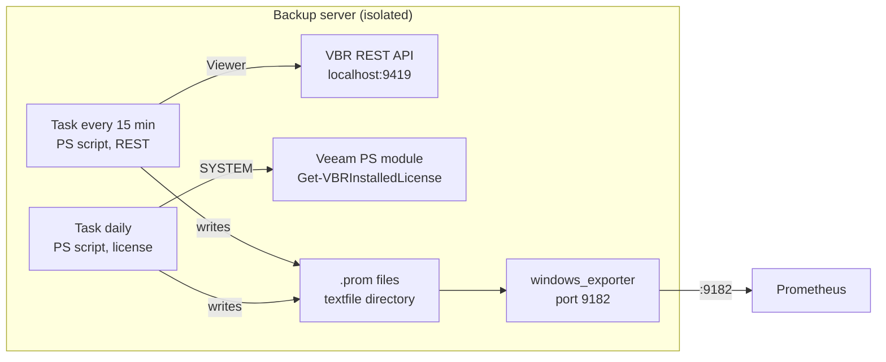

# Veeam Exporter – Metric Schema (Draft)

As of: 2026-11-06 · Source: [Claude Doc](https://claude.ai/artifact/EpxXTfynm6cMZTUmebELNa)

## Goal & Scope

For each VBR server the exporter provides five minimum signals as Prometheus metrics. Collection happens locally; delivery goes through the existing windows_exporter.

| Requirement | Question answered |
| --- | --- |
| Jobs | Which jobs exist, are they enabled, when did they last run? |
| Result | Success, Warning or Failed on the last run? |
| Unprotected VMs | Which objects of a job failed in the last run? |
| Repository storage | How much is free and used, per repository and SOBR extent? |
| License expiration | When does the license expire, how many instances are used? |

## Architecture & Data Source

A PowerShell script runs as a scheduled task locally on the VBR server, queries the REST API on localhost:9419 and writes a .prom file into the textfile directory of the windows_exporter. Prometheus keeps scraping port 9182 as today; there is no new port and no network path to the backup server.



Both tasks run locally on the backup server. The only outside traffic is the existing scrape on port 9182.

- **Interval:** every 15 minutes (proposal), so data is at most 15 minutes old. The installer allows 5 to 30 minutes: `VeeamExporterStale` fires once a REST file is older than 1 hour, so one missed run stays below that and two trigger it.
- **Installation:** manually per server with `deploy/Install-VeeamExporter.ps1`; both tasks run as SYSTEM, the REST credential is encrypted with DPAPI for SYSTEM ([deploy/README.md](../deploy/README.md)).
- **Runtime:** Windows PowerShell 5.1 and PowerShell 7, without the Veeam console and without the Veeam PS module.
- **Auth:** OAuth2 password grant on `/api/oauth2/token`; access token valid for 15 minutes, refresh token for 24 hours. Log in on every run, call `/api/oauth2/logout` at the end ([Veeam REST Overview](https://helpcenter.veeam.com/references/vbr/13/rest/1.3-rev0/tag/SectionOverview)).
- **API version:** `x-api-version` in every request. The script picks the highest revision the server offers: 1.3-rev2 (13.1), 1.3-rev1 (13.0.1), 1.3-rev0 (13.0). VBR 12 (1.2-rev1) is not supported; if the server accepts none of these revisions, the exporter fails with a message that VBR 13 is required.
- **Credential:** local Veeam user, password encrypted with DPAPI (`Export-Clixml`) for the task account; it exists only on the server itself.
- **Role:** Veeam Backup Viewer is enough for jobs, sessions and repositories. REST returns the license only to Veeam Backup Administrator, see the license section; the same applies to `/api/v1/serverInfo`, so the exporter reads the VBR version locally instead (OP-13).
- **Faulty values:** if one field of an API item cannot be converted (a timestamp, a size or a count), only the series of that field is left out, and the run writes a warning naming the item and the field (e.g. `Job 'Backup Job 1': field lastRun skipped: Invalid timestamp: '...'`). All other series of that item and all other items are written, and the collector counts as successful. A job whose `nextRun` cannot be read gets `schedule="unknown"`.
- **Writing files:** write `<name>.prom.tmp` first, then rename (atomic). UTF-8 without BOM, LF line endings, newline at end of file. Do not use `Out-File` under 5.1, it writes UTF-16.

## Jobs & Results

A single call to `GET /api/v1/jobs/states` returns all values. The Veeam Backup Viewer role is enough; each page holds 200 jobs by default ([Jobs reference](https://helpcenter.veeam.com/references/vbr/13/rest/1.3-rev0/tag/Jobs#operation/GetAllJobsStates)). Output goes to `veeam_jobs.prom`.

| Metric | Labels | Value | API field |
| --- | --- | --- | --- |
| `veeam_job_info` | job_name, job_id, job_type, workload, repository, schedule | 1 | id, type, workload, repositoryName; schedule from nextRun and nextRunPolicy |
| `veeam_job_last_result` | job_name, job_type | 0 Success, 1 Warning, 2 Failed, -1 None | lastResult |
| `veeam_job_enabled` | job_name | 1 enabled, 0 disabled | status ≠ Disabled and nextRunPolicy ≠ `<Disabled>` |
| `veeam_job_running` | job_name | 1 currently running | status = running, starting, stopping |
| `veeam_job_last_run_timestamp_seconds` | job_name | Unix time | lastRun |
| `veeam_job_next_run_timestamp_seconds` | job_name | Unix time, missing for chained and unscheduled jobs | nextRun |
| `veeam_job_objects` | job_name | number of objects in the job | objectsCount |

All metrics are gauges.

- **Label `schedule`:** how the job is started, so that dashboards and alerts can tell a job started by hand from a chained one (both have no `nextRun`):
  - `scheduled`: `nextRun` is set;
  - `chained`: `nextRunPolicy` starts with `After [` (runs after another job, e.g. `After [Linux backup job]`);
  - `none`: `nextRunPolicy` is `<Not scheduled>` (started by hand only);
  - `unknown`: anything else.

  For scheduled jobs `nextRunPolicy` is free text in the date format of the server (lab: `08.11.2026 22:00`, docs: `7/30/2025 7:00 PM`) and is not parsed.
- **Label `job_name` instead of `job`:** Prometheus sets `job` itself on scrape; a label with the same name would be renamed to `exported_job`.
- **Disabled jobs:** on VBR 13.1 a disabled file share job keeps `status` `Stopped` and keeps its `nextRun`; only `nextRunPolicy` becomes `<Disabled>` (lab test, #36). `veeam_job_enabled` therefore checks both fields.
- **Retries:** REST does not show whether a retry follows a failure ([Veeam Forum](https://forums.veeam.com/viewtopic.php?p=453319)). A Failed inside the retry window is therefore normal. Alerts need a `for` covering the window (Veeam default: 3 retries of 10 minutes each).
- **Covered job types** according to the API enum: vSphere and Hyper-V backup, vSphere replica, backup copy, agent (Windows, Linux), Cloud Director, Entra ID. Tape, file share and SureBackup are not in the enum, see open points.

## Unprotected VMs (per object)

For each job and object, the most recent task run counts. A successful retry thus overrides the previous failure automatically. Output goes to `veeam_objects.prom`.

1. `GET /api/v1/jobs/states`: map jobId → job name, so that `job_name` matches the value in `veeam_jobs.prom` exactly (also after a job is renamed).
2. `GET /api/v1/sessions` with `typeFilter=<type>` and `createdAfterFilter=<now − lookback − 1 day>`, one request per session type: map sessionId → jobId. The extra day catches sessions that started before the boundary but whose tasks started after it.
3. `GET /api/v1/taskSessions` with `createdAfterFilter=<now − lookback>`, once, paged via `skip`/`limit`: one entry per object and run with name, result, sessionId, creationTime, endTime, progress. Only tasks whose `sessionId` belongs to a session from step 2 are kept. No `sessionTypeFilter`: on VBR 13.1 `sessionTypeFilter=BackupJob` matches no file share tasks, although they report `"sessionType": "BackupJob"` (lab test, #21).
4. For each job and object, keep the entry with the newest creationTime. The job name comes from step 1; if the jobId is missing there (deleted job, type not in `jobs/states`), the name of the newest session of that job is used.

Session types: `BackupJob` and `ReplicaJob` by default, extensible via parameter. One `sessions` request per type (1.3 also accepts arrays, but a single value per request keeps the queries simple). File share jobs run under `sessionType=BackupJob` (confirmed in the lab with VBR 13.1); their task is named after the file server, not the share path.

Both endpoints are available to Veeam Backup Viewer (claims `ViewSessions`, `ViewTaskSessions`) and are in the reference from 1.2-rev0 on ([Sessions reference](https://helpcenter.veeam.com/references/vbr/13/rest/1.3-rev0/tag/Sessions#operation/GetAllTaskSessions)). Proposed lookback: 8 days, so weekly jobs do not drop out. Objects removed from a job disappear once the lookback has passed.

| Metric | Labels | Value | API field |
| --- | --- | --- | --- |
| `veeam_object_last_result` | job_name, object | 0 Success, 1 Warning, 2 Failed, -1 None | result.result |
| `veeam_object_last_run_timestamp_seconds` | job_name, object | Unix time | endTime, creationTime while running |
| `veeam_object_last_processed_bytes` | job_name, object | bytes | progress.processedSize |
| `veeam_object_last_failure_info` | job_name, object, message | 1, only for Warning or Failed | result.message |

- **Label `object` instead of `vm`:** task sessions also contain agents and file shares, e.g. `winsrv88:/C:\shares\nfs_share` in the Veeam example.
- **`message` is free text:** replace line breaks and tabs with a space, collapse multiple spaces, truncate to 200 characters, then escape `\` and `"`. Only for Warning and Failed, so the number of series stays small.
- **Running tasks:** during a run (including a retry), the most recent entry is the running task with result None (-1). A previous failure is then invisible until the run ends; `VeeamObjectFailed` restarts its `for` afterwards.
- **Cardinality:** one series per job, object and metric.

```text
# HELP veeam_object_last_result Last task run: 0 Success, 1 Warning, 2 Failed, -1 None
# TYPE veeam_object_last_result gauge
veeam_object_last_result{job_name="Backup Job 1",object="linbase01"} 0
veeam_object_last_result{job_name="Backup Job 1",object="winsrv88"} 2
veeam_object_last_failure_info{job_name="Backup Job 1",object="winsrv88",message="<result.message, truncated>"} 1
```

## Repositories

`GET /api/v1/backupInfrastructure/repositories/states` returns capacity, free space, backup usage and online status per repository, SOBR extents included ([Repositories reference](https://helpcenter.veeam.com/references/vbr/13/rest/1.3-rev0/tag/Repositories)). In addition, `GET /api/v1/backupInfrastructure/scaleOutRepositories` provides the `sobr` label. According to the reference both endpoints are available to Backup Viewer (claims `ViewRepositories`, `ViewScaleOutRepositories`), and both are paged via `skip`/`limit`. Output goes to `veeam_repositories.prom`.

| Metric | Labels | Value | API field |
| --- | --- | --- | --- |
| `veeam_repository_capacity_bytes` | repository, repository_type, host, sobr | bytes | capacityGB |
| `veeam_repository_free_bytes` | as above | bytes | freeGB |
| `veeam_repository_backup_bytes` | as above | bytes used by backup files | usedSpaceGB |
| `veeam_repository_online` | repository | 1 online, 0 offline | isOnline |
| `veeam_repository_out_of_date` | repository | 1 if components are out of date | isOutOfDate |

- **Never compute fill level from usedSpaceGB:** in the Veeam example a repository has 299.4 GB capacity, 217.8 GB free and 173.4 GB usedSpace ([example response](https://docs.blinkops.com/docs/integrations/veeam-basic-backup-and-replication/actions/list-repository-states.md)). The value counts backup files, not the volume. Compute fill level as `1 − free / capacity` instead.
- **Unit:** the API returns GB with one decimal place. Convert with 1024³ and round to whole bytes (GB means GiB, confirmed in the lab, see OP-5).
- **SOBR:** extents appear individually. The `sobr` label is the name of the SOBR, empty for standalone repositories. The source is `scaleOutRepositories` with the extent IDs from `performanceTier.performanceExtents[].id`, `capacityTier.extents[].id` and `archiveTier.extentId`. From 1.3 on, `repositories/states` also contains `scaleOutRepositoryDetails.scaleOutRepositoryId`; this takes precedence, with `membership` as the name if the ID is missing from the SOBR list.
- **Versions:** if `isOutOfDate` is missing in a response, `veeam_repository_out_of_date` is omitted for that repository. In the documentation examples `isOutOfDate` is sometimes a string (`"false"`, 1.3-rev0) and sometimes a boolean; both are read.
- **Object storage:** capacity may be missing or 0. Alerts therefore also check `capacity_bytes > 0`.

## License Expiration

The license does not come from REST but from `Get-VBRInstalledLicense` in a separate task, once a day. Reason: `GET /api/v1/license` is only available to Veeam Backup Administrator ([License reference](https://helpcenter.veeam.com/references/vbr/13/rest/1.3-rev0/tag/License#operation/GetInstalledLicense)); that would require storing an admin password on the server.

- **Task account:** SYSTEM or a local account that is Backup Administrator in VBR. No stored password.
- **Prerequisite:** Veeam PS module, which under v13 works only with PowerShell 7 and the console installed ([Veeam PowerShell v13](https://helpcenter.veeam.com/docs/vbr/powershell/global_changes_v13.html)).
- **Connection:** if there is no session (`Get-VBRServerSession`), the script connects with `Connect-VBRServer` without parameters, i.e. locally as the task account, and disconnects at the end with `Disconnect-VBRServer`. It calls no other Veeam cmdlets; writing cmdlets such as `Install-VBRLicense`, `Update-VBRLicense` or `Enable-VBRLicenseAutoUpdate` are excluded by a test.
- **Output:** `veeam_license.prom`, separate from the REST files, replaced only on success. If this task fails, jobs and repositories keep working.
- **Health:** the license task writes `veeam_exporter_collector_success{collector="license"}` and the duration to its own file `veeam_exporter_license.prom`, on every run. In `veeam_exporter.prom` the two tasks would overwrite each other.

| Metric | Labels | Value | Field in `VBRInstalledLicense` |
| --- | --- | --- | --- |
| `veeam_license_info` | edition, license_type, status, licensed_to | 1 | Edition, Type, Status, LicensedTo |
| `veeam_license_valid` | – | 1 if Status = Valid | Status |
| `veeam_license_expiration_timestamp_seconds` | – | Unix time, only if set | ExpirationDate |
| `veeam_license_support_expiration_timestamp_seconds` | – | Unix time, only if set | SupportExpirationDate |
| `veeam_license_instances_licensed` | – | count | InstanceLicenseSummary |
| `veeam_license_instances_used` | – | count | InstanceLicenseSummary |

Fields according to [VBRInstalledLicense](https://helpcenter.veeam.com/docs/vbr/powershell/vbrinstalledlicense.html) and [VBRInstanceLicenseSummary](https://helpcenter.veeam.com/docs/vbr/powershell/vbrinstancelicensesummary.html): `LicensedInstancesNumber` and `UsedInstancesNumber`. Values according to [Enums](https://helpcenter.veeam.com/docs/vbr/powershell/enums.html): Status Valid, Expired, Invalid; Type Rental, Perpetual, Subscription, Evaluation, Free, Empty, NFR; Edition Community, Standard, Enterprise, EnterprisePlus, Unspecified.

- **"Only if set":** a date is missing if it is empty or equals `DateTime.MinValue` or `DateTime.MaxValue` (assumption for perpetual licenses, OP-3). Without `InstanceLicenseSummary` (e.g. a socket-only license) both instance metrics are missing.

## Exporter Health

Each collector writes its own file and replaces it only on success. The age of the file therefore shows since when a collector has been stuck; no extra state files are needed. `veeam_exporter.prom` (REST task) and `veeam_exporter_license.prom` (license task) are written on every run, including on failure: when the logon fails or the credential cannot be read, when the collector list is invalid, and even when the exporter's own module cannot be loaded. The collectors that could not run then report `veeam_exporter_collector_success` 0; without the module `veeam_exporter_info` is missing from the file.

The same metric may appear in several files as long as the label values differ. An identical series in two files, however, makes the windows_exporter (v0.25.1) discard **all** textfile metrics (`windows_textfile_scrape_error` = 1). The HELP text and label names of a metric must be identical in all files. A test checks both across the files of both tasks.

| Metric | Labels | Value | Source |
| --- | --- | --- | --- |
| `veeam_exporter_collector_success` | collector | 1 last run ok, 0 failure | script |
| `veeam_exporter_collector_duration_seconds` | collector | duration in seconds | script |
| `veeam_exporter_info` | script_version, api_version, vbr_version | 1 | script; `vbr_version` is the file version of the VBR backup service binary (service `VeeamBackupSvc`), empty if it cannot be read or if `-BaseUri` points to another machine than the one the exporter runs on (OP-13) |
| `windows_textfile_mtime_seconds` | file | modification time of each .prom file | windows_exporter |
| `windows_textfile_scrape_error` | – | 1 if a file cannot be read | windows_exporter |

Values for `collector`: jobs, objects, repositories, license. The textfile collector provides the two windows_exporter metrics on its own ([textfile docs](https://github.com/prometheus-community/windows_exporter/blob/v0.25.1/docs/collector.textfile.md)).

## Example Alerts

Ten Grafana-managed alert rules cover the minimum requirements and the exporter itself. The thresholds are proposals. They are implemented in [`alerting/veeam-alerts.json`](../alerting/veeam-alerts.json), a Grafana alerting provisioning file (folder `Veeam`, group `veeam`, evaluated every minute). The file is a template: nothing loads it automatically, users pick the rules they need (README, "Alert rules").

Every rule has two steps: query `A` is an instant Prometheus query that returns the measured value per series, and the condition `B` is a threshold on `A`. The rule fires for each series of `A` that meets the threshold for the time given in `for`. Grafana shows the value of `A` in the alert and in `$values.A.Value` for the `summary` annotation, which every rule has.

- `for: 45m` covers the retry window (3 × 10 minutes) plus one script interval.
- `VeeamJobNotRun` assumes daily jobs and skips jobs without a schedule (`schedule="none"`), which are started by hand. Jobs that never ran have no last run timestamp and do not fire here. Exporters older than the `schedule` label alert for all enabled jobs.
- `VeeamJobNeverRun` covers those jobs (OP-10): enabled, with a schedule or chained, and no last run at all. 26 hours give a new daily job time for its first run. Jobs without a schedule and disabled jobs are left out as in `VeeamJobNotRun`; a job that ran with an unknown result (-1, OP-8) has a last run timestamp and does not fire.
- The fill level comes from free space and capacity, never from `veeam_repository_backup_bytes`, which counts backup files only.
- `VeeamLicenseExpiring` also fires once the license has expired; `A` is negative then.
- A collector replaces its file only on success, so an old file means failed or missing runs. The REST task runs every 15 minutes, the license task once a day; `VeeamExporterLicenseStale` therefore allows 48 hours instead of 1.
- `noDataState` is `OK`: a query without series (no license file yet, no repositories) is not an alert. `execErrState` is `Error`, so a failing query shows up as a `DatasourceError` alert.
- The data source of `A` is `${VEEAM_PROMETHEUS_DATASOURCE_UID}`; Grafana replaces it with the environment variable of that name when it loads the file.
- Labels: `severity` (`critical` or `warning`) for the notification policies, plus the labels of the series.

```yaml
- alert: VeeamJobFailed
  query: veeam_job_last_result and on(instance, job_name) veeam_job_running == 0
  condition: A == 2
  for: 45m
  severity: critical
- alert: VeeamJobWarning
  query: veeam_job_last_result
  condition: A == 1
  for: 45m
  severity: warning
- alert: VeeamObjectFailed
  query: veeam_object_last_result
  condition: A == 2
  for: 45m
  severity: critical
- alert: VeeamJobNotRun
  query: (time() - veeam_job_last_run_timestamp_seconds) / 3600 and on(instance, job_name) veeam_job_enabled == 1 and on(instance, job_name) veeam_job_info{schedule!="none"}
  condition: A > 26
  for: 1h
  severity: warning
- alert: VeeamJobNeverRun
  query: veeam_job_last_result unless on(instance, job_name) veeam_job_last_run_timestamp_seconds and on(instance, job_name) veeam_job_enabled == 1 and on(instance, job_name) veeam_job_info{schedule!="none"}
  condition: A == -1
  for: 26h
  severity: warning
- alert: VeeamRepositoryFull
  query: 1 - veeam_repository_free_bytes / veeam_repository_capacity_bytes and veeam_repository_capacity_bytes > 0
  condition: A > 0.85
  for: 1h
  severity: warning
- alert: VeeamRepositoryOffline
  query: veeam_repository_online
  condition: A == 0
  for: 15m
  severity: critical
- alert: VeeamLicenseExpiring
  query: (veeam_license_expiration_timestamp_seconds - time()) / 86400
  condition: A < 30
  for: 0s
  severity: warning
- alert: VeeamExporterStale
  query: (time() - windows_textfile_mtime_seconds{file=~".*veeam_(jobs|objects|repositories)\\.prom"}) / 3600
  condition: A > 1
  for: 0s
  severity: warning
- alert: VeeamExporterLicenseStale
  query: (time() - windows_textfile_mtime_seconds{file=~".*veeam_license\\.prom"}) / 3600
  condition: A > 48
  for: 0s
  severity: warning
```

Units of `A`: result codes for the first three rules and `VeeamJobNeverRun` (0 Success, 1 Warning, 2 Failed, -1 None), hours for `VeeamJobNotRun` and the two exporter rules, a fraction from 0 to 1 for `VeeamRepositoryFull`, 1 or 0 for `VeeamRepositoryOffline`, days for `VeeamLicenseExpiring`.

## Open Points & Next Steps

These points can only be settled in the lab; they change details, not the architecture. In the code, `# ASSUMPTION:` marks the spot and refers to the point here (e.g. `docs/metrics.md#OP-7`).

- [x] **OP-1** Role for `repositories/states` and `scaleOutRepositories`: is Veeam Backup Viewer enough? According to the reference yes, in all revisions from 1.2-rev1 to 1.3-rev2 ("Available to … Backup Viewer"). Lab test with VBR 13.1 (November 2026): confirmed, including a scale-out repository.
- [ ] **OP-2** Tape, file share and SureBackup jobs: do they appear in `jobs/states`, e.g. as Unknown? Otherwise cover them via `/api/v1/sessions`. Lab test with VBR 13.1 (November 2026): file share jobs appear with `type` `FileBackup` and `workload` `File`. The configuration backup job does not appear in `jobs/states` (its sessions have `sessionType` `ConfigurationBackup`). Tape and SureBackup still open (no tape or VMs in the lab).
- [ ] **OP-3** Test the license task under v13 as SYSTEM (PowerShell 7, console) and check ExpirationDate for a perpetual license. Assumption: `MinValue`/`MaxValue` means "not set". Also check whether `Get-VBRInstalledLicense` ever returns more than one object; the script then takes the first one and warns. Lab test with VBR 13.1 (November 2026): the task runs as SYSTEM with `pwsh.exe` and finds the module via `PSModulePath`; SYSTEM is Backup Administrator through the role assignment of the local Administrators group. With a trial license (Enterprise Plus, Evaluation) the command returns one object and the expiration date is correct. Still open: perpetual license, more than one license object.
- [ ] **OP-4** Object storage repositories: what does capacityGB return?
- [x] **OP-5** Is the unit GB = GiB? Compare against the console. Lab test with VBR 13.1 (November 2026): yes. `capacityGB` × 1024³ of a repository on a 59.9 GiB volume gives 64317135258 bytes, the volume size. The API rounds to 0.1 GB, so `veeam_repository_*_bytes` are exact to about 107 MB only.
- [x] **OP-6** VBR 12.0 to 12.2 (API 1.1): does `taskSessions` exist yet? Settled from the OpenAPI specs (1.1-rev0 to 1.3-rev2): `taskSessions` is missing in all 1.1 revisions and present from 1.2-rev0 on. Moot since VBR 12 support was dropped; the minimum is now VBR 13.0 (1.3-rev0).
- [x] **OP-7** Version probe: how does the server answer an unsupported `x-api-version` on the token request? Settled in the lab (VBR 13.1): HTTP 400 with `{"errorCode":"NotImplemented","message":"... does not support the API version '1.3-rev3'."}`; wrong credentials give HTTP 401 with `errorCode` `AccessDenied`. Any other error response aborts the probe immediately, so a wrong password is never tried once per version. Under Windows PowerShell 5.1 the exporter lost the error body (stream already read by `Invoke-WebRequest`), so the probe stopped at the first unsupported revision; fixed in #22.
- [ ] **OP-8** Unknown values in `lastResult` or `result.result` (e.g. empty or a new enum value): assumption -1 like None.
- [x] **OP-9** Timestamps without a time zone: assumption local time of the VBR server (where the exporter runs). In the documentation examples `jobs/states` and `sessions` carry an offset, `taskSessions` does not (`"creationTime": "2024-11-13T22:00:49.893878"`); the start times there fall on full hours like a local schedule. Check in the lab whether real responses carry an offset. Lab test with VBR 13.1 (November 2026): same as in the docs: `jobs/states` and `sessions` carry the offset of the server (`+01:00`), `taskSessions` does not and are local time of the server. A task that ended at 09:14:50 local time is exported as 1794125690 (08:14:50 UTC), as in `tests/fixtures/lab/vbr-13.1`.
- [x] **OP-10** Jobs without `lastRun` (never run): `veeam_job_last_run_timestamp_seconds` is then missing. `VeeamJobNotRun` does not fire for these jobs; consider a separate alert on `veeam_job_last_result == -1`. Lab test with VBR 13.1 (November 2026): a job created but never started has no `lastRun`; the exporter writes `veeam_job_last_result -1` and no `veeam_job_last_run_timestamp_seconds`, as assumed. Settled: the separate alert `VeeamJobNeverRun` covers enabled jobs with a schedule or chain that never ran (see Example Alerts).
- [ ] **OP-11** Which session type do agent jobs run under? From 1.3 on there are also `AgentBackup`, `AgentPolicy`, `EndpointBackup` and `BackupCopyJob`. If agent tasks end up there, they are missing from `veeam_objects.prom` with the default `BackupJob,ReplicaJob` and have to be added via parameter.
- [x] **OP-12** Does a SOBR itself appear as a row in `repositories/states` (type `ExtendableRepository` in the enum)? Then sums over all repositories count the extents twice; build sums over `sobr=""` plus extents, or exclude the SOBR row. For now the exporter outputs the row unchanged. Lab test with VBR 13.1 (November 2026): no. Only the two extents appear, each with the `sobr` label; a sum over all rows counts every extent once.
- [x] **OP-13** According to the reference, `GET /api/v1/serverInfo` is only available to Backup Administrator. With the viewer account, `vbr_version` in `veeam_exporter_info` stays empty (HTTP 403, no warning). Alternative: read the version locally from the installation. Lab test with VBR 13.1 (November 2026): confirmed, HTTP 403 for Backup Viewer. Settled: the exporter runs on the VBR server and reads the version locally, as the file version of the binary of the service `VeeamBackupSvc` (`ImagePath` in `HKLM:\SYSTEM\CurrentControlSet\Services\VeeamBackupSvc`). In the lab `Veeam.Backup.Service.exe` has file version 13.1.2.57, the same as `buildVersion` from `serverInfo` with a Backup Administrator account and the `DisplayVersion` of "Veeam Backup & Replication Server". The exporter no longer calls `serverInfo`. Patches: see OP-15.
- [ ] **OP-14** Socket licenses: `SocketLicenseSummary` (`LicensedSocketsNumber`, `UsedSocketsNumber` per platform) is not exported yet. Only needed if socket licenses are still in use.
- [ ] **OP-15** Patches and the local VBR version (OP-13): does the file version of the backup service binary still equal `serverInfo.buildVersion` after a patch? According to [KB2680](https://www.veeam.com/kb2680) some patches get a build number of their own (13.0.1 P1 = 13.0.1.1071), others keep the build number of the release (12.0.0.1420 P20230718); `serverInfo` lists those separately under `patches`, which the exporter never exported. Assumption: the binary has the build number of the release or patch, like `buildVersion`. Check with the next VBR 13.1 patch in the lab (compare with `serverInfo` read by a Backup Administrator). The version is read on every run, so an update or a moved installation (path from the service registration) shows up with the next run; while the binary is missing during an update, `vbr_version` stays empty for that run, with a warning.

1. Script skeleton: auth, version probe, atomic writing, jobs collector. Done.
2. Test against a v13 server, store example .prom files. Done in the lab with VBR 13.1; real responses and the resulting `veeam_objects.prom` are in `tests/fixtures/lab/vbr-13.1`.
3. Add the object, repository and license collectors, Grafana dashboard and alert rules. Done; the alert rules are a template in `alerting/`, users pick the ones they need.
4. Rollout manually per server: install script, two tasks, encrypted credential (see `deploy/README.md`). Install, update and uninstallation work in the lab; no production server yet.

## Sources

- [Veeam REST API Overview 1.3](https://helpcenter.veeam.com/references/vbr/13/rest/1.3-rev0/tag/SectionOverview)
- [Jobs reference](https://helpcenter.veeam.com/references/vbr/13/rest/1.3-rev0/tag/Jobs#operation/GetAllJobsStates)
- [Sessions reference](https://helpcenter.veeam.com/references/vbr/13/rest/1.3-rev0/tag/Sessions#operation/GetAllTaskSessions)
- [License reference](https://helpcenter.veeam.com/references/vbr/13/rest/1.3-rev0/tag/License#operation/GetInstalledLicense)
- [Repositories reference](https://helpcenter.veeam.com/references/vbr/13/rest/1.3-rev0/tag/Repositories)
- [VBRInstalledLicense](https://helpcenter.veeam.com/docs/vbr/powershell/vbrinstalledlicense.html)
- [Veeam PowerShell v13 Global Changes](https://helpcenter.veeam.com/docs/vbr/powershell/global_changes_v13.html)
- [windows_exporter textfile collector](https://github.com/prometheus-community/windows_exporter/blob/v0.25.1/docs/collector.textfile.md)
- [Veeam Forum: retry status via REST](https://forums.veeam.com/viewtopic.php?p=453319)
